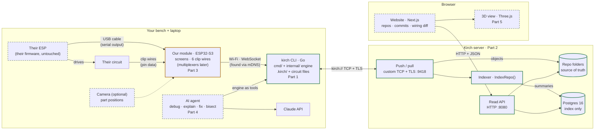

# Kirch

**Git for hardware circuits.** Save versions of a circuit, see what changed in the wiring, go back, and debug the real board with a Wi-Fi probe and an AI agent.

```
kirch init
kirch add .
kirch commit -m "servo on GPIO9"
kirch diff HEAD~1     # wiring:  SERVO1.SIG: U1.GPIO9 → U1.GPIO10
```

Built from scratch in Go. Kirch stores data exactly like git, so real git is our test checker.

---

## System design



Green = built · amber = in progress · dashed = planned.

### Connections

| From → to | Protocol | Port |
|---|---|---|
| `kirch push` / `pull` / `clone` → server | Custom TCP + TLS (`kirch://`) | 9418 |
| Website → server | HTTP + JSON | 8080 |
| Their ESP → our module | USB cable (their serial output, read only) | — |
| Their circuit → our module | Clip wires (pin data) | — |
| Probe → laptop | WebSocket (on TCP) | — |
| Laptop finds probe | mDNS (on UDP) | 5353 |
| Server → Postgres | Postgres protocol (`pgx`) | 5432 |

Custom TCP only where we control both ends (CLI and server). HTTP wherever a browser is involved.

### How a circuit gets in (the user writes nothing)

1. The user plugs their ESP into our module with one USB cable and clips on its wires. Their firmware is never changed.
2. Kirch reads their ESP code without changing it (`servo.attach(9)`), the pins our clip wires measure (50 Hz pulses on GPIO9) and whatever their ESP prints, and drafts the circuit. Our module forwards everything over Wi-Fi to the laptop (Flask server).
3. The user confirms "is this right?"; Kirch builds the drawing and a 3D digital twin itself (a camera, if there is one, adds where parts really sit).

### How a change moves

1. Change the circuit or firmware, then `kirch commit`. The engine saves it in `.kirch/`, byte-identical to git.
2. `kirch push` opens a TLS connection on `kirch://`, sends only the missing objects, and the server writes them into that repo's folder.
3. The server runs `IndexRepo()`, which copies new commits and branches into Postgres.
4. The website calls the HTTP API. Lists come from Postgres; diffs and files are read from the repo folder by the same engine.

### Design rules

- **One engine.** The CLI, server and agent all call the same Go functions in `internal/`.
- **Repo folders are the truth.** Postgres can be rebuilt from them at any time.
- **Real git checks us.** Tests compare our ids and output with git's, byte for byte.
- **The agent only suggests.** Fixes arrive as a new branch you approve; it never rewrites history.

---

## Status — 25 Nov 2026

| Part | What | Status | Owner |
|---|---|---|---|
| 0 | Setup: plan, data formats, CI, release builds (v0.1.0) | ✅ Done | Hridhayesh |
| 1 | `kirch` command line: init, add, commit, log, status, branch, diff, reset, revert, merge, clone/push/pull to a folder | ✅ Done | Hridhayesh |
| 2 | Platform — **B. backend**: TCP push/pull, Postgres, indexer, HTTP API, Docker | ✅ Done (branch `server-backend/Evin`) | Evin |
| 2 | Platform — **A. product spec** (draft below, "Website plan") + **C. website** | 🔨 Draft | Hridhayesh |
| 2 | Platform — **D. getting circuits in**: draft circuit from the user's ESP code + data | ⬜ Planned | Hridhayesh |
| 3 | Our module: firmware built, flashed, Bluetooth works; next: Wi-Fi test, their ESP's serial output over USB, screens (multiplexers later) | 🔨 In progress | Hridhayesh |
| 4 | AI agent (`explain`, `debug`, `fix`, `bisect --auto`) | ⬜ Planned | Open |
| 5 | 3D digital twin (auto-layout, optional camera) + 3D diff | ⬜ Planned | Open |

Full checklist: [`PLAN.md`](PLAN.md)

---

## Circuit files

What a Kirch commit stores for a circuit. Every file starts with `"format": "kirch.<name>/1"`.

| File | What it says |
|---|---|
| `parts.json` | The parts: `{"SERVO1": {"type": "servo", "model": "SG90"}}` |
| `netlist.json` | Which pins are connected: `{"SIG": ["SERVO1.SIG", "U1.GPIO9"]}` |
| `layout.json` | Where parts sit (for the 3D view) |
| `capture.json` | What the probe measured |
| `firmware/` | The circuit's code (normal text diff) |

- A pin is written `PART.PIN` (`U1.GPIO9`), and a pin can be in only one net.
- `kirch add` tidies these files (sorted, one item per line), so the same circuit always gives the same file.
- The wiring diff reads each pin's net: `SERVO1.SIG: U1.GPIO9 → U1.GPIO10`.
- Merge is net by net: two branches changing the same net differently is a conflict.

---

## Website plan (draft — needs both of us to agree)

**Idea:** show what changed in a circuit and whether it still works. Wires, parts and real measurements, not just files.

v1 pages:
- **Circuit page** — the circuit drawn; click a part or a net to see its connections.
- **Commits** — each one says what changed in wires ("2 wires moved").
- **One commit** — changed wires highlighted, then parts, then code, then readings.
- **Wire history** — every commit that moved one pin ("git blame for wires").
- **Branches + compare** — ahead / behind, and whether two branches can merge.
- **Readings** — probe values across commits (after `kirch capture` works).

Kept small in v1: log in with GitHub, all repos public, about 15 API calls. Pull requests, private repos, teams and 3D come later.

To agree: circuit-first (not a GitHub copy) · GitHub login · public only · the pages above · the API list · site name.

---

## Our probe module

ESP32-S3 + screens + clip wires (multiplexers later). It measures the user's circuit, reads what their ESP prints over USB (we never change their firmware), and sends everything to the laptop over Wi-Fi.

**First setup:** the module shows up over Bluetooth as `KIRCH_xxxxxx`. In the **ESP BLE Provisioning** phone app pick it, enter code `kirch1234`, then your 2.4 GHz Wi-Fi. It then appears as `kirch-probe.local` and sends readings every second (`ws://kirch-probe.local:81/`), re-sending any that get lost. Hold BOOT for 3 s at power-on to forget the Wi-Fi.

| Clip | GPIO | Reads |
|---|---:|---|
| P1 | 8 | voltage (min / max / avg) |
| P2, P3, P4 | 3, 16, 21 | pulses (period, high time) — P4 = servo |
| P5 | 9 | voltage |
| P6 | 48 | on / off |

```bash
cd firmware && pio run -t upload              # flash once over USB
python firmware/tools/probe_listen.py         # see readings on the laptop
python firmware/tools/fake_probe.py --drop 0.2 # test without the board
```

---

## Try it

Download `kirch` from the [v0.1.0 release](https://github.com/Kirch-log/Kirch/releases/tag/v0.1.0), or build it:

```
go build -o kirch .
./kirch init
./kirch config user.name "Your Name"
./kirch config user.email "you@example.com"
./kirch add .
./kirch commit -m "first"
./kirch log
```

Tests: `go test ./...` (needs git installed for the comparison tests; database tests use `KIRCH_TEST_DATABASE_URL` or a throwaway local Postgres, and skip if neither exists).

---

## Run the server

```
docker compose up --build                      # Postgres + kirch-server
docker compose cp server:/data/tls/cert.pem kirch-dev-cert.pem
export KIRCH_CA_FILE=$PWD/kirch-dev-cert.pem   # trust the dev certificate

kirch remote add origin kirch://localhost/evin/servo-board
kirch push                                     # creates the repo on first push
curl localhost:8080/api/repos/evin/servo-board/commits
```

| Endpoint | Returns |
|---|---|
| `GET /healthz` | `{"status":"ok"}` |
| `GET /api/repos` | every repo with its latest commit |
| `GET /api/repos/{owner}/{name}` | one repo + branch names |
| `GET /api/repos/{owner}/{name}/branches` | branches with their tip commits |
| `GET /api/repos/{owner}/{name}/commits?branch=&limit=&offset=` | history, `kirch log` order, paged |
| `GET /api/repos/{owner}/{name}/commits/{id}` | one commit + changed files |
| `GET /api/repos/{owner}/{name}/commits/{id}/diff` | patches + wiring changes for `netlist.json` |
| `GET /api/repos/{owner}/{name}/commits/{id}/files` | every file in that commit |
| `GET /api/repos/{owner}/{name}/commits/{id}/raw/{path}` | one file's contents |

Without Docker: `go run ./server` (settings are environment variables, listed at the top of [`server/main.go`](server/main.go)). End-to-end check: `scripts/e2e-server.sh`.
