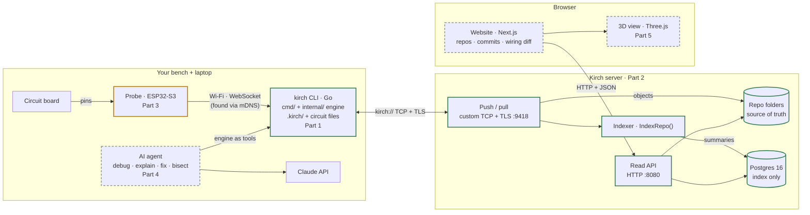

# Kirch

**Git for hardware circuits.** Save versions of a circuit, see what changed in the wiring, go back, and debug the real board with a Wi-Fi probe and an AI agent.

```
kirch init
kirch add .
kirch commit -m "servo on GPIO9"
kirch diff HEAD~1     # wiring:  SERVO1.SIG: U1.GPIO9 → U1.GPIO10
```

Built from scratch in Go. Kirch stores data exactly like git, so real git is our test checker.

---

## System design



Green = built · amber = in progress · dashed = planned.

### Connections

| From → to | Protocol | Port |
|---|---|---|
| `kirch push` / `pull` / `clone` → server | Custom TCP + TLS (`kirch://`) | 9418 |
| Website → server | HTTP + JSON | 8080 |
| Probe → laptop | WebSocket (on TCP) | — |
| Laptop finds probe | mDNS (on UDP) | 5353 |
| Server → Postgres | Postgres protocol (`pgx`) | 5432 |

Custom TCP only where we control both ends (CLI and server). HTTP wherever a browser is involved.

### How a change moves

1. Edit `netlist.json` or firmware, then `kirch commit`. The engine saves it in `.kirch/`, byte-identical to git.
2. `kirch push` opens a TLS connection on `kirch://`, sends only the missing objects, and the server writes them into that repo's folder.
3. The server runs `IndexRepo()`, which copies new commits and branches into Postgres.
4. The website calls the HTTP API. Lists come from Postgres; diffs and files are read from the repo folder by the same engine.

### Design rules

- **One engine.** The CLI, server and agent all call the same Go functions in `internal/`.
- **Repo folders are the truth.** Postgres can be rebuilt from them at any time.
- **Real git checks us.** Tests compare our ids and output with git's, byte for byte.
- **The agent only suggests.** Fixes arrive as a new branch you approve; it never rewrites history.

---

## Status — 14 Nov 2026

| Part | What | Status | Owner |
|---|---|---|---|
| 0 | Setup: plan, data formats, CI, release builds (v0.1.0) | ✅ Done | Hridhayesh |
| 1 | `kirch` command line: init, add, commit, log, status, branch, diff, reset, revert, merge, clone/push/pull to a folder | ✅ Done | Hridhayesh |
| 2 | Platform — **B. backend**: TCP push/pull, Postgres, indexer, HTTP API, Docker | ✅ Done (branch `server-backend/Evin`) | Evin |
| 2 | Platform — **A. product spec** + **C. website** | ⬜ Planned | Open |
| 3 | Probe: firmware built, flashed, Bluetooth works; Wi-Fi test next | 🔨 In progress | Hridhayesh |
| 4 | AI agent (`explain`, `debug`, `fix`, `bisect --auto`) | ⬜ Planned | Open |
| 5 | 3D view + 3D diff | ⬜ Planned | Open |

Full checklist: [`PLAN.md`](PLAN.md) · File formats: [`docs/formats.md`](docs/formats.md) · Probe: [`firmware/README.md`](firmware/README.md)

---

## Try it

Download `kirch` from the [v0.1.0 release](https://github.com/Kirch-log/Kirch/releases/tag/v0.1.0), or build it:

```
go build -o kirch .
./kirch init
./kirch config user.name "Your Name"
./kirch config user.email "you@example.com"
./kirch add .
./kirch commit -m "first"
./kirch log
```

Tests: `go test ./...` (needs git installed for the comparison tests; database tests use `KIRCH_TEST_DATABASE_URL` or a throwaway local Postgres, and skip if neither exists).

---

## Run the server

```
docker compose up --build                      # Postgres + kirch-server
docker compose cp server:/data/tls/cert.pem kirch-dev-cert.pem
export KIRCH_CA_FILE=$PWD/kirch-dev-cert.pem   # trust the dev certificate

kirch remote add origin kirch://localhost/evin/servo-board
kirch push                                     # creates the repo on first push
curl localhost:8080/api/repos/evin/servo-board/commits
```

| Endpoint | Returns |
|---|---|
| `GET /healthz` | `{"status":"ok"}` |
| `GET /api/repos` | every repo with its latest commit |
| `GET /api/repos/{owner}/{name}` | one repo + branch names |
| `GET /api/repos/{owner}/{name}/branches` | branches with their tip commits |
| `GET /api/repos/{owner}/{name}/commits?branch=&limit=&offset=` | history, `kirch log` order, paged |
| `GET /api/repos/{owner}/{name}/commits/{id}` | one commit + changed files |
| `GET /api/repos/{owner}/{name}/commits/{id}/diff` | patches + wiring changes for `netlist.json` |
| `GET /api/repos/{owner}/{name}/commits/{id}/files` | every file in that commit |
| `GET /api/repos/{owner}/{name}/commits/{id}/raw/{path}` | one file's contents |

Without Docker: `go run ./server` (settings are environment variables, listed at the top of [`server/main.go`](server/main.go)). End-to-end check: `scripts/e2e-server.sh`.
